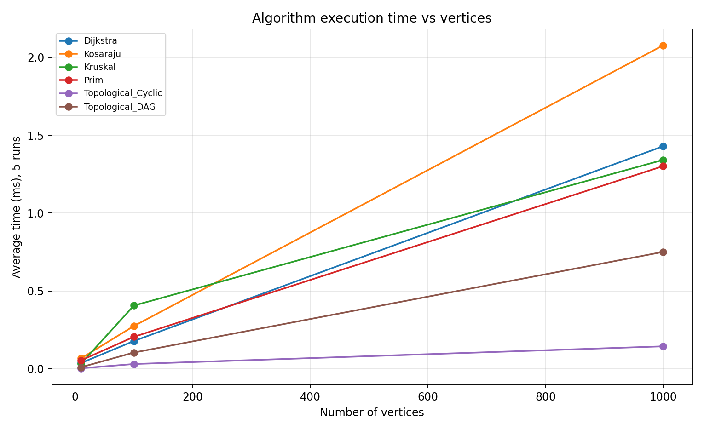
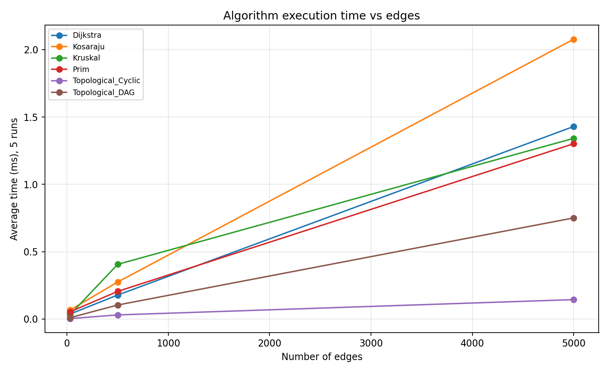

# Assignment 3 — Smart City Infrastructure and Route Planning

## Overview
A Java 17 graph application for urban infrastructure: minimum-cost undirected road networks, directed service/road connectivity, topological dependencies, and shortest routes. Vertices represent districts; weighted edges represent construction cost or distance. Graphs use adjacency lists and an edge list. All vertex identifiers are zero-based.

## Implementation
- `graph.Graph`: directed/undirected weighted adjacency lists; each undirected road is stored once in the edge list and twice in adjacency lists.
- `dsu.DSU`: path compression and union by rank.
- `mst.MST`: Kruskal (sort edges, union endpoints) and Prim (min-priority queue). Both return total weight, connectivity, and operation counts. For disconnected graphs they return a minimum spanning *forest*, with `connected=false`.
- `connectivity.Connectivity`: Kahn topological ordering (empty result indicates a cycle) and iterative Kosaraju SCC (avoids recursive stack overflow).
- `shortestpath.Dijkstra`: binary min-heap, predecessor tracking, `Long.MAX_VALUE` for unreachable nodes, and `path(target)` reconstruction. Nonnegative weights are enforced by `Graph.add`.
- `Main`: deterministic generators, correctness tests, timed benchmarks, and CSV export.

## Complexity Analysis
Assuming adjacency lists and binary priority queues, V vertices and E edges:

| Algorithm | Time | Extra space | Explanation |
|---|---|---|---|
| DSU `find`, `union` | Amortized O(α(V)) | O(V) | Compression flattens paths; union by rank keeps trees shallow; α is inverse Ackermann. |
| Kruskal | O(E log E + E α(V)) | O(V+E) | Edge sorting dominates; DSU tests edges. |
| Prim | O(E log E) | O(V+E) | Heap insertion and removal for candidate roads. |
| Kosaraju SCC | O(V+E) | O(V+E) | Two traversals and transpose graph. |
| Kahn topological sort | O(V+E) | O(V) | Each vertex and directed edge processed once. |
| Dijkstra | O((V+E) log V) | O(V+E) | Binary heap with lazy stale-entry skipping. |

## Experimental Setup
Java `System.nanoTime()` timing; **five measured repetitions** per algorithm and graph size, preceded by three warm-up executions. Times in the CSV are arithmetic means in milliseconds. Fixed random seeds: `42+V` for undirected graphs, `100+V` for cyclic-capable directed graphs, and `200+V` for DAGs. The sizes are (V,E) = (10,30), (100,500), (1000,5000).

Undirected graphs begin with a random spanning tree, then add random unique undirected edges; thus they are connected. DAG edges are oriented from lower to higher vertex IDs, preventing cycles. General directed graphs sample unique ordered pairs independently; they **may contain cycles**, and cycle detection is measured explicitly. Edge weights are random integers 1–100. Dijkstra is benchmarked on the connected undirected graph with source vertex 0. Benchmarks run sequentially on one JVM; garbage collection, JIT compilation, and host load can affect times.

**Operation counting definitions:** Kruskal: edge examinations plus DSU find/union calls (including recursive find calls); Prim: heap removals plus adjacency-edge examinations; Dijkstra: heap removals plus adjacency-edge examinations. Topological sorting: V+E nominal vertex/edge processing budget; Kosaraju: 2(V+E) nominal traversal budget. The last two are analytical counts, **not instrumented actual visits**, and may overstate work on cyclic graphs where Kahn stops early. Sorting comparisons and heap internal comparisons are not counted. Therefore operation counts are not directly comparable across different algorithms.

## Results
Actual measured CSV from this execution: [`results/tables/benchmark.csv`](results/tables/benchmark.csv). Values depend on machine/JVM. Rerun to refresh them.

| V | E | Kruskal (ms) | Prim (ms) | SCC (ms) | Topological DAG (ms) | Topological cyclic-capable (ms) | Dijkstra (ms) |
|---:|---:|---:|---:|---:|---:|---:|---:|
| 10 | 30 | 0.0324 | 0.0535 | 0.0664 | 0.0095 | 0.0028 | 0.0365 |
| 100 | 500 | 0.4059 | 0.2049 | 0.2745 | 0.1038 | 0.0303 | 0.1779 |
| 1000 | 5000 | 1.3418 | 1.3016 | 2.0778 | 0.7506 | 0.1439 | 1.4296 |





Note: E increases together with V in this experiment, so the two plots show the same samples against different horizontal scales; they do not independently isolate edge density.

## Comparison and Discussion
Kruskal and Prim returned identical MST weights on all connected generated graphs. Kruskal spends time sorting all edges, while Prim maintains a frontier of candidate roads. Their relative measured speed depends on graph density, priority-queue overhead, and JVM state; small differences in millisecond-scale results should not be overinterpreted. DSU optimizations keep Kruskal's repeated connectivity checks nearly constant amortized time. Kosaraju, topological ordering, and Dijkstra scale with the number of vertices and edges as predicted by their theoretical bounds, though short timed runs can be noisy. A cyclic directed graph can cause Kahn's algorithm to terminate before processing all vertices, so it may appear faster than a DAG. The directed random graph is not guaranteed cyclic by construction; the CSV records whether a cycle was detected for each generated sample. Dijkstra does not work in general with negative weights: settling a vertex may be premature when a later negative edge improves its distance; negative cycles can make finite shortest paths undefined.

## Testing
Running `Main` first executes assertions covering: connected weighted MST with known total (7); disconnected graph; unreachable vertex; single vertex; duplicate edge weights and multiple MSTs; valid DAG ordering; directed cycle rejection; strongly connected graph; partition into multiple SCCs; and known shortest-path distance. Every generated connected graph also checks that Kruskal and Prim produce the same total MST weight. The SCC tests check component counts on known partitions. These are deterministic correctness checks, not a proof for all graphs.

## Reproduce
Requires **JDK 17+**, Python 3 and matplotlib for plots. From the project root:

```bash
javac -d out src/graph/Graph.java src/dsu/DSU.java src/mst/MST.java src/connectivity/Connectivity.java src/shortestpath/Dijkstra.java src/Main.java
java -cp out Main
python make_plots.py
```

Windows PowerShell uses the same commands if `javac`, `java`, and `python` are on PATH. The CSV is overwritten on each benchmark run. `out/` is ignored by Git.

## Conclusion
Use Kruskal or Prim for affordable connected infrastructure networks; DSU supports efficient component merging. Use Kosaraju to identify mutually reachable directed regions, Kahn ordering to schedule acyclic dependencies and detect cycles, and Dijkstra to plan routes when all distances are nonnegative. Algorithm choice should reflect graph direction, connectivity, edge weights, and graph size.

